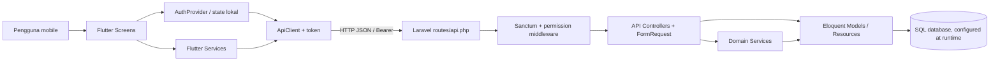

# 02 — Arsitektur dan Struktur Proyek

## Struktur aktual

```text
delcheck/
├── delcheck_flutter/              # Klien Flutter/Dart
│   ├── lib/core/                  # AppConfig, HTTP client, format
│   ├── lib/models/                # Model dan parser JSON
│   ├── lib/providers/             # AuthProvider (ChangeNotifier)
│   ├── lib/screens/               # Semua screen aplikasi
│   ├── lib/services/              # Klien endpoint per domain
│   ├── lib/widgets/               # Widget reusable (chip status, sheet pengiriman)
│   ├── assets/images/             # Logo
│   ├── android/, ios/, web/, ...  # Runner per platform
│   └── pubspec.yaml
├── delcheck_laravel/              # Laravel API
│   ├── app/Enums, Exceptions, Http/{Controllers,Requests,Resources}
│   ├── app/Models, Providers, Services, Support, Traits
│   ├── bootstrap/                 # Registrasi route, middleware dan exception
│   ├── config/                    # Konfigurasi Laravel dan permission
│   ├── database/{factories,migrations,seeders}
│   ├── routes/{api,web,console}.php
│   ├── tests/{Feature,Unit}
│   └── composer.json
├── docs/                          # Dokumentasi
├── PRD.MD                         # Kebutuhan produk draft
└── README.MD
```

## Teknologi, state, dan pola

| Lapisan | Bukti implementasi |
|---|---|
| UI mobile | Flutter / Dart (`pubspec.yaml`, 35 file di `lib/`) |
| State global | Provider: `Provider<ApiClient>` dan `ChangeNotifierProvider<AuthProvider>` di `main.dart` |
| State layar | Banyak screen memakai `StatefulWidget`, state lokal dan `setState`; tidak ditemukan pola repository terpisah |
| HTTP | `package:http` di `core/api_client.dart`; `RegisterService` memiliki `http.Client` sendiri |
| Token | Laravel Sanctum token; di klien ditulis ke `FlutterSecureStorage` |
| Backend | Laravel 12, PHP 8.2+, API JSON; controller menggunakan service untuk aturan domain |
| ORM | Eloquent model dan relasi; migration schema Laravel |
| RBAC | Spatie Laravel Permission, permission middleware dan `HasRoles` |
| Database | Driver default config `sqlite`; tersedia config SQLite/MySQL/PostgreSQL. Database live tidak diperiksa |

**[KESIMPULAN ANALISIS]** Ini arsitektur client-server dengan endpoint REST bergaya resource/action. Backend tidak sepenuhnya MVC tipikal yang semua logika berada di controller: beberapa aturan dipisahkan dalam service (`PesananService`, `StokService`, `VerifikasiRetailService`, dll.). Tidak ada repository layer yang teridentifikasi. Flutter memakai service domain sebagai pembungkus HTTP, namun bukan repository abstraksi.



## Routing dan navigasi

Laravel API route didaftarkan di `bootstrap/app.php`, yang memasang `routes/api.php`; prefix `/api` berasal dari routing API framework. Flutter menggunakan `Navigator` dan `MaterialPageRoute` (bukan named route). `AuthGate` menjadi root: status sesi `memeriksa` menampilkan spinner, `masuk` membuka `HomeScreen`, dan `keluar` membuka `LoginScreen`. Beranda membuat screen sesuai menu. Daftar retailer membuka `AdminDetailRetailerScreen(retailer: item)` dan membaca bool hasil pop untuk refresh.

## Konfigurasi / batasan

`AppConfig.baseUrl` saat ini literal alamat LAN `http://192.168.43.188:8000/api`, timeout 20 detik. Nilai URL bukan secret, tetapi spesifik jaringan development. Jangan menyimpulkan deployment/prod dari nilai ini. `.env` sengaja tidak dibaca. `main.dart` memberi `ThemeData(colorSchemeSeed: Colors.indigo, useMaterial3: true)`; banyak warna UI juga didefinisikan lokal per screen. Widget reusable yang ditemukan: `StatusPesananChip`, `CatatPengirimanBottomSheet`.
