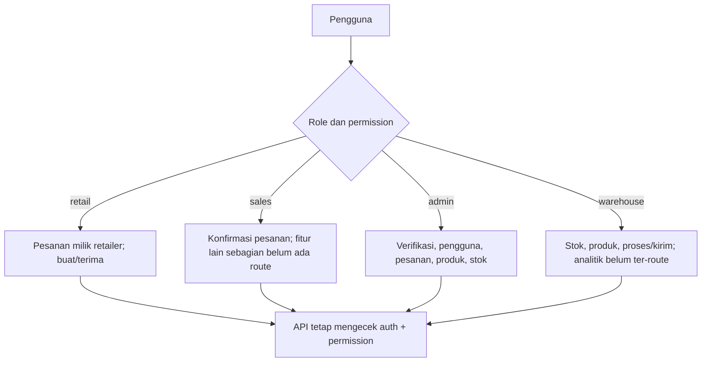

# 03 — Role dan Hak Akses

## Role yang ditetapkan

Empat role di `App\Enums\Peran` dan `RolePermissionSeeder::peta()` adalah `retail`, `sales`, `admin`, `warehouse`. Seeder memakai guard `web`; `User` mengaktifkan `HasRoles`. Middleware API memeriksa permission spesifik, sehingga izin server adalah sumber keputusan akhir.

| Role | Menu / UI yang ditemukan | Izin penting dari seeder | Batasan yang terbukti |
|---|---|---|---|
| Retail | Beranda, Pesan Produk; screen pesanan dipakai bersama | `produk.lihat`, `pesanan.buat`, `pesanan.lihat-sendiri`, `pesanan.terima`, dll. | Pesanan dibatasi ke retailer user di `PesananController::batasiUntuk`; hanya status `dikirim` bisa diterima; daftar produk hanya aktif |
| Sales | Role seeder; UI khusus sales terbatas/tidak ada dashboard menu sales yang lengkap | `pesanan.konfirmasi`, `pesanan.lihat-binaan`, `kunjungan.kelola`, `kinerja.lihat`, dll. | Catatan Seeder menyebut MVP menafsirkan cakupan `lihat-binaan` sebagai semua pesanan; belum ada scope assignment di controller. Ini tidak sejalan dengan BR-05 |
| Admin | Verifikasi Retail, Kelola Akun, Pengiriman, Produk, Stok | `retailer.verifikasi`, `pengguna.kelola`, `pesanan.proses`, `pengiriman.perbarui`, dll. | API membatasi endpoint dengan permission. Backend melarang menonaktifkan diri sendiri. Aktivasi Retail belum terverifikasi harus melalui alur verifikasi |
| Warehouse | Pengiriman, Produk, Stok dalam `HomeScreen` | `stok.kelola`, `produk.kelola`, `pesanan.proses`, `pengiriman.perbarui`, izin analitik/klaim | Tabel permission menyatakan dapat mengelola produk dan stok, tetapi tidak semua izin memiliki API route implementasi |

**[TERBUKTI DI KODE]** `HomeScreen` menyembunyikan menu tertentu berdasar role, tetapi UI filtering bukan perlindungan keamanan. Backend menambahkan `auth:sanctum` dan `permission:*` di API. `bootstrap/app.php` alias permission middleware Spatie. Tidak ditemukan middleware `role:*` pada route API; otorisasi API utamanya permission-based.

## Matriks izin yang dibuat seeder

- Retail: `dashboard.lihat`, `produk.lihat`, `pesanan.buat`, `pesanan.lihat-sendiri`, `pengiriman.pantau`, `pesanan.terima`, `laporan-barang.lihat-sendiri`, `laporan-barang.buat`, `retur.ajukan`, `profil-toko.lihat-sendiri`.
- Sales: `dashboard.lihat`, `produk.lihat`, `pesanan.buat`, `pesanan.lihat-binaan`, `pesanan.konfirmasi`, `pengiriman.pantau`, `retur.konfirmasi`, `laporan-barang.lihat-binaan`, `profil-toko.lihat-binaan`, `kunjungan.kelola`, `kinerja.lihat`.
- Admin: `dashboard.lihat`, `produk.lihat/kelola`, `stok.kelola`, `pesanan.lihat-semua/proses`, `pengiriman.pantau/perbarui`, `retailer.lihat-daftar/verifikasi`, `pengguna.kelola`, `ulasan.lihat`.
- Warehouse: `dashboard.lihat`, `produk.lihat/kelola`, `stok.kelola`, `pesanan.lihat-semua/proses`, `pengiriman.pantau/perbarui`, `analitik.sebaran-retail`, `analitik.akar-masalah`, `klaim.putuskan`, `analitik.mutu-kemasan`, `retur.pantau-logistik`, `laporan-barang.lihat-semua/ekspor`.

Daftar izin bukan bukti bahwa menu atau endpoint fitur tersebut selesai. Endpoint aktual ada di [07-api](07-DOKUMENTASI-API.md); ketidaksesuaian cakupan dibahas di [13-risiko](13-ANALISIS-BUG-DAN-RISIKO.md).

**[BELUM DAPAT DIPASTIKAN]** Hak akses data per wilayah/assignment untuk Sales dan Warehouse tidak bisa dibuktikan konsisten. PRD menyebut batasan binaan, sementara controller pesanan memberikan semua record kepada user yang memiliki `pesanan.lihat-binaan`.
