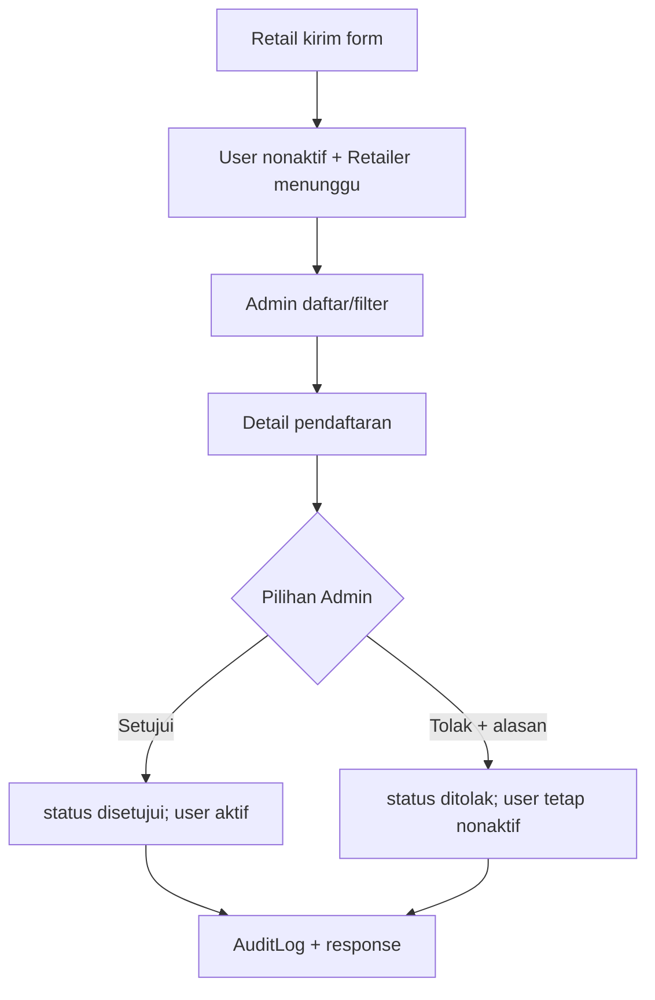

# 04 — Alur Bisnis Seluruh Fitur

Keterangan di bawah membedakan API/UI yang ada dari fitur yang baru didefinisikan pada PRD.

## Modul yang memiliki implementasi end-to-end/API

### 1. Registrasi dan login
1. Login screen menerima identitas/password dan memanggil `AuthProvider.login` → `AuthService.login` → `POST /auth/login`.
2. Backend memvalidasi satu identifier, memeriksa password, status aktif/status verifikasi, mencatat `last_login_at`, membuat token Sanctum dan mengirim `UserResource`.
3. Flutter menyimpan token dengan secure storage, mengambil/me-parse user, lalu `AuthGate` membuka Home.
4. Registrasi publik memuat wilayah dari `GET /wilayah`, kemudian `POST /auth/register`; server membuat akun role Retail nonaktif dan record Retailer berstatus menunggu dalam transaksi.

### 2. Verifikasi pendaftaran Retail
Admin memuat daftar terfilter/paginasi; memilih record membuka detail dengan objek hasil list. Setujui menampilkan konfirmasi lalu `POST /admin/pendaftaran-retail/{id}/setujui`; tolak meminta alasan lalu `POST .../{id}/tolak`. Service mengunci record, memvalidasi status, memperbarui Retailer/user, menulis audit log, lalu resource JSON kembali. Daftar direfresh jika detail pop dengan `true`.

### 3. Kelola akun
Admin memuat daftar user dengan query `q`, `role`, `aktif`, pagination. Toggle meminta konfirmasi; service backend menolak operasi duplikat, menahan aktivasi Retail yang belum disetujui, mencegah Admin menonaktifkan dirinya, serta mencabut seluruh token saat akun dinonaktifkan. UI mengganti item atau mengeluarkannya dari daftar berdasarkan filter.

### 4. Katalog produk
`ProdukListScreen` memanggil daftar/filter/paginasi. Retail/Sales hanya melihat `is_active=true`; pengguna dengan izin `produk.kelola` dapat melihat status aktif/nonaktif. Form create/update memakai validasi server dan delete memanggil `SoftDeletes` (secara kode endpoint disebut soft delete). Tidak ada model Flutter pemetaan kategori detail/foto UI yang dapat dibuktikan sebagai unggah file.

### 5. Stok dan mutasi
Screen stok mencari dan memfilter produk menipis; detail menampilkan saldo dan riwayat serta melakukan mutasi masuk/keluar. Controller membungkus mutasi dalam transaksi. `StokService::ubah` mengunci row, menolak saldo negatif, memperbarui stok dan merekam signed quantity di `mutasi_stok`.

### 6. Pesanan
- Retail membuat pesanan dari produk aktif; API menguji stok saat pembuatan, snapshot nama/harga/satuan, hitung total dan simpan header/items dalam transaksi.
- Sales menyetujui/menolak pesanan menunggu; alasan tolak wajib; perubahan dicatat audit.
- Admin/Warehouse dapat menyerahkan pesanan yang sudah dikonfirmasi ke kurir (`diproses`), lalu mengirim. Endpoint kirim bisa menerima status `dikonfirmasi` maupun `diproses`, mengecek stok dengan row locks, membuat mutasi keluar, mencatat Pengiriman dan audit dalam transaksi.
- Retail hanya dapat membatalkan sebelum Sales memproses, dengan alasan, atau mengonfirmasi terima dari status `dikirim`.

## Modul belum terbukti operasional

Migration dan Seeder mendefinisikan laporan barang/klaim/retur, ulasan, jadwal kunjungan, notifikasi, dan target penjualan. Sebagian role permission juga merujuk fitur ini. Namun route/controller/service/screen lengkap tidak ditemukan untuk seluruhnya. PRD mendeskripsikan use case yang jauh lebih luas dari implementasi repository; jangan menganggap UC-W, UC-R laporan/retur, UC-S kunjungan/kinerja, dashboard metrik, notifikasi push sudah selesai.

## Penanganan kegagalan umum

Laravel FormRequest menghasilkan validasi, umumnya HTTP 422. `ApiException` mengembalikan JSON dengan `success:false`, `message`, `kode`, optional `errors`; permission exception dikonversi ke 403 berkode `TIDAK_PUNYA_AKSES`. Flutter `ApiClient` mengubah status/body menjadi `ApiException`, memanggil callback logout lokal pada 401 dan memberi message fallback untuk jaringan/timeout. Tiap screen mengelola loading/error lokal; beberapa aksi menampilkan SnackBar/Dialog.
