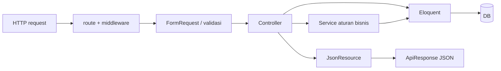

# 06 — Dokumentasi Backend Laravel

## Siklus request

`bootstrap/app.php` mendaftarkan `routes/api.php`, alias middleware Spatie (`role`, `permission`, `role_or_permission`) dan renderer JSON bagi `UnauthorizedException`. Route mengarah ke `Api` Controller. Controller memvalidasi melalui FormRequest atau `$request->validate`, memanggil service/model, membungkus hasil melalui `ApiResponse` dan JsonResource.

## Controller, method, dan kaitan

| File/class | Method | Tujuan dan dependency |
|---|---|---|
| `AuthController` | `register(RegisterRetailRequest)`, `login(LoginRequest)`, `logout(Request)`, `me(Request)` | `AuthService`; `UserResource`; register khusus Retail, login menerbitkan token Sanctum |
| `WilayahController` | `index(Request)` | Validasi filter, query `Wilayah`, `WilayahResource` |
| `Admin/PendaftaranRetailController` | `index`, `show`, `setujui`, `tolak` | `VerifikasiRetailService`, `RetailerResource`; list default status menunggu, filter pencarian dan paginasi |
| `Admin/PenggunaController` | `index`, `aktifkan`, `nonaktifkan` | `PenggunaService`, `PenggunaResource`; query role/status/search |
| `Admin/SalesController` | `index()` | Mengambil user role Sales aktif untuk opsi assignment |
| `ProdukController` | `index`, `show`, `store`, `update`, `destroy`, `dataTersaring` | Query produk, `ProdukRequest`; hapus memakai soft delete model |
| `StokController` | `index`, `show`, `riwayat`, `ubah`, `denganStok` | `StokService`, transaksi DB, resources stok/mutasi |
| `PesananController` | `index`, `show`, `store`, `batalkan`, `setujui`, `tolak`, `proses`, `kirim`, `terima`, `batasiUntuk` | `PesananService`, validasi, scope Retail vs non-Retail |

Method bisnis terperinci: `AuthService::registerRetail/login/pastikanBolehLogin`; `VerifikasiRetailService::setujui/tolak/kunciDanPastikanStatus`; `PenggunaService::aktifkan/nonaktifkan`; `StokService::ubah`; `PesananService::buat/batalkan/terima/setujui/tolak/proses/kirim/kunci/pastikanMilik`.

## Validasi, resource, dan error

FormRequest memisahkan rules: `RegisterRetailRequest`, `LoginRequest`, `SetujuiRetailRequest`, `TolakRetailRequest`, `ProdukRequest`, `MutasiStokRequest`, `BuatPesananRequest`, `AlasanPesananRequest`, `KirimPesananRequest`. `authorize()` umumnya `true`; izin terutama middleware route. `ApiResponse::success` menghasilkan `{success,message,data}`; daftar paginate berisi `data.items` dan `data.meta` (`halaman`, `per_halaman`, `total`, `halaman_terakhir`). `ApiException` JSON berisi success false, message, kode dan optional errors. FormRequest Laravel memberi 422 validasi; permission exception di bootstrap memberi 403 khusus.

## Transaksi dan integritas

Transaksi eksplisit dipakai registrasi, verifikasi, aktivasi/nonaktif akun, perubahan stok, dan transisi pesanan. `lockForUpdate()` pada status retailer/pesanan/user/stok melindungi aksi bersamaan; `StokService` menjaga stok tidak negatif serta membuat log mutasi. Audit log dibuat saat beberapa transisi status; model `AuditLog` menolak update/delete via event model. Penggunaan locking bergantung DB engine dan transaction isolation, sehingga **[PERLU PENGUJIAN]** pada DB target.

## Kode backend yang belum mempunyai jalur API

Model/migration untuk klaim, retur, ulasan, laporan barang, kunjungan, target, notifikasi dan device token tidak berpadanan dengan Controller/route mobile lengkap dalam repo yang diperiksa. `routes/api.php` saat ini hanya route wilayah, auth, admin retailer/account/sales, produk, stok, pesanan. Ini batasan implementasi, bukan pernyataan fitur tidak direncanakan.
