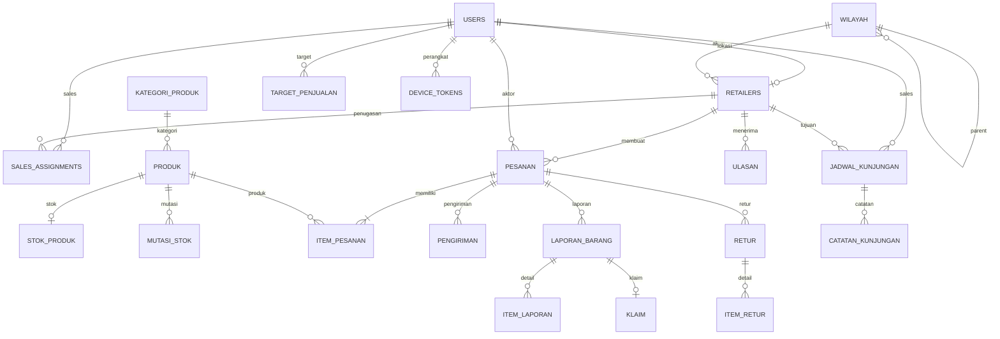

# 09 — Migration dan ERD

## Urutan migration

Laravel mengurutkan berdasarkan nama timestamp file. Terdapat 19 file di `delcheck_laravel/database/migrations/`:

| Urutan | File | `up()` / `down()` dan catatan ketergantungan |
|---|---|---|
| 1 | `0001_01_01_000000_create_users_table.php` | `users`, `password_reset_tokens`, `sessions`; down drop ketiganya |
| 2 | `0001_01_01_000001_create_cache_table.php` | `cache`, `cache_locks`; down drop keduanya |
| 3 | `0001_01_01_000002_create_jobs_table.php` | `jobs`, `job_batches`, `failed_jobs`; down drop ketiganya |
| 4 | `2026_10_26_100002_create_wilayah_table.php` | `wilayah` self FK; down drop wilayah |
| 5 | `...100003_create_retailers_table.php` | `retailers` references users/wilayah; soft delete |
| 6 | `...100004_create_sales_assignments_table.php` | assignment references users/retailers; unique pasangan |
| 7 | `...100005_create_kategori_produk_table.php` | kategori |
| 8 | `...100006_create_produk_table.php` | produk references kategori; membuat juga harga_produk yang refer ke produk/retailers |
| 9 | `...100007_create_stok_table.php` | stok_produk + mutasi_stok; references produk/users |
| 10 | `...100008_create_pesanan_table.php` | pesanan + item_pesanan; references retailers/users/produk |
| 11 | `...100009_create_pengiriman_table.php` | references pesanan/users |
| 12 | `...100010_create_laporan_barang_table.php` | laporan_barang, item_laporan, klaim, foto_bukti; refs pesanan/retailers/users/produk/item |
| 13 | `...100011_create_retur_table.php` | retur + item_retur; refs order/laporan/retailer/user/item/produk |
| 14 | `...100012_create_ulasan_table.php` | ulasan references retailers/users/pesanan |
| 15 | `...100013_create_kunjungan_tables.php` | jadwal_kunjungan, catatan_kunjungan, target_penjualan |
| 16 | `...100014_create_notifikasi_tables.php` | notifications + device_tokens |
| 17 | `...100015_create_audit_logs_table.php` | audit_logs polymorphic |
| 18 | `2026_10_26_144158_create_permission_tables.php` | Spatie permissions, roles, pivots; nama mengikuti config permission |
| 19 | `2026_10_27_091450_create_personal_access_tokens_table.php` | Sanctum polymorphic tokens |

Setiap `down()` menghapus tabel yang dibuat migration, umumnya urutan terbalik dependensi internal. Hanya dokumentasi: migration/rollback tidak dijalankan.

## ERD (relasi migration, bukan bukti database live)

Diagram tidak menggambarkan relasi polymorphic `foto_bukti`, `audit_logs`, `mutasi_stok.referensi`, `notifications.notifiable`, Sanctum `tokenable`, atau pivot Spatie agar tidak menyiratkan FK biasa. Kolom dan constraint lengkap tercantum di migration; nullable, default, index, unique serta foreign-key behavior dijelaskan di dokumen 08.

## Perhatian urutan

`produk` dibuat setelah `retailers` dan kategori, sehingga `harga_produk` dapat membuat foreign key retailer. `personal_access_tokens` dibuat setelah base schema. File permission membaca tabel dari `config/permission.php` dan mengosongkan cache ketika migrate. Perilaku ini dilihat dari source migration; tidak membuktikan urutan migration berhasil di database tertentu.
