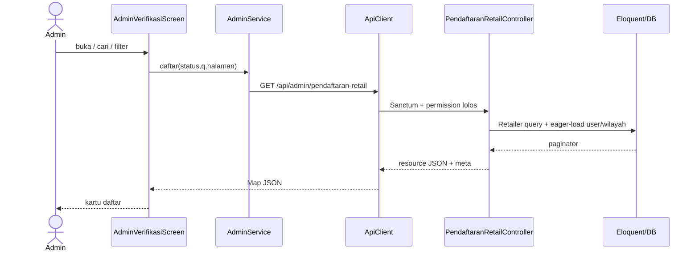
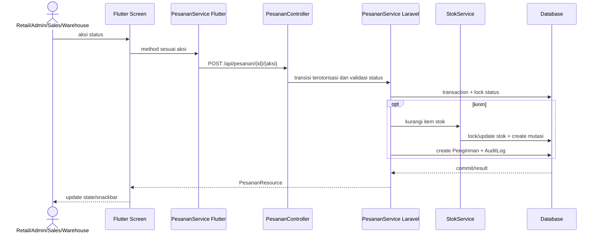

# 10 — Alur Data End-to-End

## A. Verifikasi pendaftaran Retail

`admin_verifikasi_screen.dart::_muatAwal` → `AdminService.daftar(status,q,halaman)` → `ApiClient.get('/admin/pendaftaran-retail?...')` → route dengan `auth:sanctum` + `permission:retailer.verifikasi` → `PendaftaranRetailController::index` validasi filter, eager-load `user/wilayah/diverifikasiOleh`, query `Retailer`, `RetailerResource` → `ApiResponse::paginated` → parser `RetailerPendaftar.fromJson` → `setState(_items, _total, halaman)`.

Saat memilih item, `_buka(item)` memberikan object `RetailerPendaftar` langsung ke `AdminDetailRetailerScreen(retailer:item)` via `MaterialPageRoute`. Screen detail belum memanggil GET detail API; field detail menggunakan data yang ada di response list. Backend `show()` tersedia namun tidak dipanggil klien ini.

## B. Setujui/tolak pendaftaran

Setujui: `_setujui()` dialog bool → `_jalankan(() => _service.setujui(r.id))` → POST action tanpa body (sales id optional) → controller `SetujuiRetailRequest` → service transaction/lock → ubah status, aktifkan user, optional assignment, audit log → resource response → SnackBar → pop(true) → daftar reload.

Tolak: `_TolakDialog` mewajibkan alasan tidak kosong → POST body `alasan` → FormRequest max500 → transaction/lock status menunggu → set ditolak, catat aktor/alasan/audit → response SnackBar/pop(true). Error bisnis `PENDAFTARAN_SUDAH_DIPROSES` juga mem-pop agar daftar sinkron.

## C. Pesanan dan stok

## D. Session auth

Login response token → Flutter set `ApiClient.token` dan secure storage → request berikutnya menambah Bearer header. `/auth/me` hydrate user/roles. Pada 401, `_send` memanggil `onUnauthorized`; Provider membersihkan token dan state, sehingga `AuthGate` beralih ke login.

## E. Kelola akun

Admin screen service membangun query string `q/role/aktif/page/per_page` → API controller query `User` eager-load roles/retailer, paginasi `PenggunaResource` → parser Dart → kartu UI. Aksi kirim POST aktifkan/nonaktifkan; backend service mengunci row dan update; nonaktifkan menghapus semua token. Klien menukar model pada list atau menghapusnya saat tidak sesuai filter.

**[PERLU PENGUJIAN]** Response actual, latency, SQL persis, rollback terhadap DB target, perilaku saat race antar-admin dan status migration perlu environment integration. Tidak ada data database live yang dijadikan contoh.
