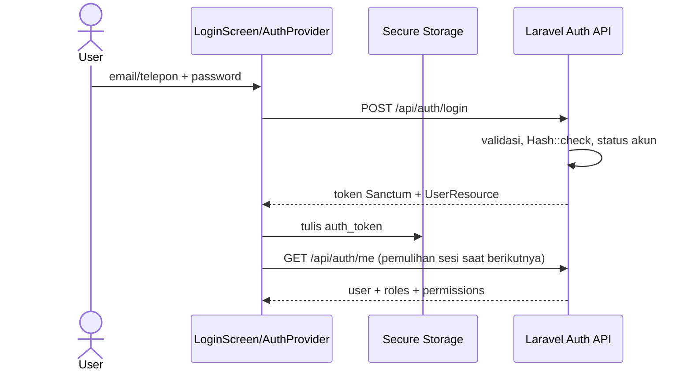

# 11 — Autentikasi dan Otorisasi

## Login dan pemulihan sesi

1. `AuthProvider.mulai()` membaca `auth_token` dari `FlutterSecureStorage`.
2. Jika token tidak ada, state `keluar`; jika ada, token ditempel ke `ApiClient`, kemudian `AuthService.me()` meminta `GET /auth/me` melalui `auth:sanctum`.
3. Login di Laravel mencari user berdasarkan email atau phone, `Hash::check`, memanggil `pastikanBolehLogin`, menyimpan `last_login_at`, dan membuat token dengan `$user->createToken(device_name)->plainTextToken`.
4. Flutter menulis token ke secure storage, menaruh `AppUser` di provider, dan `AuthGate` menampilkan Home.
5. Logout mencoba `POST /auth/logout` yang menghapus current token; Flutter tetap menghapus sesi lokal walaupun API gagal.
6. HTTP 401 memicu callback untuk bersihkan sesi; user kembali ke login.

## Otorisasi server

Autentikasi menjawab “siapa pengguna ini?” (Sanctum Bearer token). Otorisasi menjawab “bolehkah pengguna melakukan tindakan ini?” (`permission:*` middleware Spatie dan pemeriksaan domain). `routes/api.php` mengunci route admin retailer dengan `retailer.verifikasi`, account `pengguna.kelola`, produk lihat/kelola, stok `stok.kelola`, dan aksi pesanan.

Pembatasan tambahan: retail hanya pesanan retailer sendiri (`PesananController::batasiUntuk`), role yang tidak punya permission ditolak middleware 403. Login memblokir retailer menunggu/ditolak dan user `is_active=false`. Nonaktifkan akun mencabut seluruh Sanctum tokens. Admin tidak dapat menonaktifkan akun dirinya sendiri.

## Catatan implementasi dan batas

- Token disimpan secure storage (plugin); tidak ada masa expiry eksplisit pada config route di source yang diperiksa; migration punya kolom `expires_at` optional. **[BELUM DAPAT DIPASTIKAN]** expiry runtime mungkin dipengaruhi konfigurasi Sanctum yang tidak dikaji penuh.
- `AuthService::pastikanBolehLogin` mengecek verifikasi Retail dan `is_active`, tetapi tidak memanggil `hasPermission` karena role bukan policy login; route tetap melakukan permission.
- LoginRequest backend mengharapkan `email` atau `phone`. Flutter `AuthService.login` mengirim `email` atau field `telepon`; mismatch telepon didokumentasikan di [13-risiko](13-ANALISIS-BUG-DAN-RISIKO.md).
- Tidak ditemukan proteksi route di Flutter selain AuthGate berbasis sesi dan menyembunyikan menu berdasar role. Keamanan tetap bergantung backend.
- Jangan memakai kredensial sample seeder di produksi. Seeder menyebut password contoh secara eksplisit untuk local/testing; tidak ditampilkan ulang di sini.
